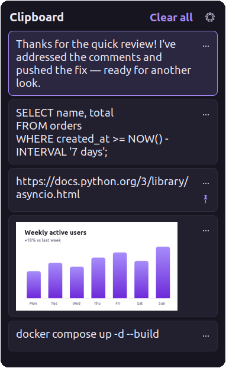

<div align="center">

# SuperV

**Clipboard for Linux.** The Windows Win+V clipboard history: same panel, same keys.

Press <kbd>Super</kbd> + <kbd>V</kbd> on Linux and get the clipboard history you know from Windows.
Ubuntu, Linux Mint, Debian, Fedora, Arch, openSUSE and more.


<picture>
  <source media="(prefers-color-scheme: light)" srcset="docs/screenshot-light.png">
  
</picture>

</div>

## Why SuperV

Linux has no clipboard history out of the box, and some desktops lose the clipboard when you close the app you copied from. SuperV copies how Windows does it:

| | Windows (Win+V) | SuperV |
|---|:---:|:---:|
| History panel on <kbd>Win</kbd>/<kbd>Super</kbd> + <kbd>V</kbd> | ✓ | ✓ |
| Text **and** images (screenshots too) | ✓ | ✓ |
| Click or <kbd>Enter</kbd> pastes into the app you were using | ✓ | ✓ |
| Keeps the last 25 items, newest first | ✓ | ✓ |
| Copying something again moves it to the top | ✓ | ✓ |
| Pin items; pinned items survive restarts | ✓ | ✓ |
| History clears on restart (except pinned) | ✓ | ✓ |
| ⋯ menu: Delete, Pin/Unpin, Clear all | ✓ | ✓ |
| Turn history off; the panel offers **Turn on** | ✓ | ✓ |
| Clipboard survives closing the source app | ✓ | ✓ |
| Password managers' copies are not recorded | ✓ | ✓ |
| <kbd>Super</kbd> + <kbd>Shift</kbd> + <kbd>S</kbd> screenshot → lands in history | ✓ | ✓ |
| Pick your **own** shortcut | ✗ | ✓ |
| Theme: System / Light / Dark | ✓ | ✓ |
| Adjustable text size in the panel | ✗ | ✓ |
| Move & resize the panel (remembered) | | ✓ |
| Free and open source | ✗ | ✓ |

## Install

Pick your Linux family. Every package is a few dozen KB and sets up click-to-paste for you.

### Ubuntu and Linux Mint: PPA (recommended, updates arrive with your system updates)

```bash
sudo add-apt-repository ppa:saikatnjm/superv
sudo apt install superv
```

Then **open SuperV once**: press <kbd>Super</kbd>, type **SuperV** and press <kbd>Enter</kbd> (on Mint: open the **Menu** and search for **SuperV**).
New versions then come through **Software Updater** (Ubuntu), **Update Manager** (Mint) or `sudo apt upgrade`.
The PPA covers Ubuntu 22.04, 24.04, 26.04 and 26.10, Linux Mint 21 and 22, and other systems based on them (Pop!_OS, Zorin, elementary).

### Ubuntu, Linux Mint, Debian, Pop!_OS, Zorin, elementary (no terminal)

1. Download **[superv_amd64.deb](https://github.com/saikatnjm/superv/releases/latest/download/superv_amd64.deb)**.
2. Double-click it and choose **Install** (Ubuntu Software, or Package Installer on Mint). Enter your password once.
3. **Open SuperV once to finish setup.** Press <kbd>Super</kbd>, type **SuperV** and press <kbd>Enter</kbd> (on Mint: open the **Menu** and search for **SuperV**).
   This first launch starts SuperV and sets up <kbd>Super</kbd> + <kbd>V</kbd>. After that, SuperV starts by itself every time you log in.

Needs Ubuntu 22.04 / Mint 21 / Debian 12 or newer. On older releases, use the source install below.

### Fedora, openSUSE

1. Download **[superv.x86_64.rpm](https://github.com/saikatnjm/superv/releases/latest/download/superv.x86_64.rpm)**.
2. Double-click it to open it in **Software** (or run `sudo dnf install ./superv.x86_64.rpm`, or `sudo zypper install ./superv.x86_64.rpm` on openSUSE).
3. Open **SuperV** once from your app menu.

### Arch, Manjaro, EndeavourOS

```bash
git clone https://github.com/saikatnjm/superv.git
cd superv/packaging/arch && makepkg -si
```

Or download the ready-built **[superv-x86_64.pkg.tar.zst](https://github.com/saikatnjm/superv/releases/latest/download/superv-x86_64.pkg.tar.zst)** and run `sudo pacman -U superv-x86_64.pkg.tar.zst`. Then open **SuperV** once from your app menu.

### Any other Linux: from source

```bash
git clone https://github.com/saikatnjm/superv.git
cd superv
./install.sh                          # or: ./install.sh --hotkey "<Ctrl><Alt>v"
```

`install.sh` installs into your home folder, fetches any missing build tools with apt, dnf, pacman or zypper, and asks for your password **once** to turn on click-to-paste. Skip that with `./install.sh --no-sudo`; the panel then shows an **Enable** button that asks through the normal desktop password dialog when you want it.

### Updating

Installed from the PPA? Updates arrive with your normal system updates (`sudo apt update && sudo apt upgrade`). Otherwise, install the new package the same way. **SuperV notices it was updated and restarts itself into the new version** as soon as the panel is closed, keeping what's on your clipboard. (Coming from 1.1.2 or older? Run `superv --quit` and open SuperV once; from 1.2.0 on, this is automatic.)

### Your own shortcut, theme and text size

Open the panel and click ⚙:

- **Shortcut:** click it and press a combo that uses **Super**, or **Ctrl+Alt**, plus a key (e.g. <kbd>Super</kbd>+<kbd>V</kbd>, <kbd>Ctrl</kbd>+<kbd>Alt</kbd>+<kbd>V</kbd>). A green ✓ confirms it's saved; if a combo can't be used, SuperV tells you why. (Ctrl+V, Ctrl+Shift+V and Alt+V are refused because apps need them for pasting and menus.) SuperV moves conflicting desktop shortcuts out of the way and restores them if you change your mind. Changed it in your desktop's own keyboard settings instead? SuperV picks that up too.
- **Theme:** System, Light or Dark.
- **Text size:** A− / A+, from 80% to 160%, for the clipboard items. The default is 100%, your desktop's normal size.
- **Clear history** removes everything except pinned items. **Reset settings** puts theme, text size, panel size and position, and the shortcut back to their defaults; your history is kept.

Drag the panel's header to move it and drag any edge to resize it; SuperV remembers both. Double-click the header to reset.

## Keyboard shortcuts

| Keys | What it does |
|---|---|
| <kbd>Super</kbd> + <kbd>V</kbd> | Open / close clipboard history (or your own shortcut) |
| <kbd>↑</kbd> <kbd>↓</kbd> | Move between items |
| <kbd>Enter</kbd> or click | Paste the item into the app you were using |
| <kbd>Delete</kbd> | Remove the selected item |
| <kbd>Esc</kbd> or click elsewhere | Close the panel |
| <kbd>Super</kbd> + <kbd>Shift</kbd> + <kbd>S</kbd> | Screenshot; the image appears in your history |
| <kbd>Ctrl</kbd> + <kbd>C</kbd> / <kbd>X</kbd> / <kbd>V</kbd> | Work as always |

## Lightweight by design

SuperV is a single C program **under 100 KB** built on GTK 3, which Ubuntu and Mint already have loaded in memory. It uses no interpreter, no Electron and no runtime.

| | |
|---|---|
| Size | under 100 KB (packages around 35 KB) |
| Memory | ~7 MB private (~27 MB RSS, most of it GTK pages shared with your desktop) |
| CPU when idle | 0%: it wakes only when the clipboard changes |
| Popup | ~0.1 s from shortcut to panel |

The setup helper (`superv-setup`, Python) only runs during install or when you change the shortcut.

## Works on

| Desktop | Distros | Session | Status |
|---|---|---|---|
| GNOME | Ubuntu, Fedora Workstation, Debian, Pop!_OS 22.04, Zorin, Arch/Manjaro GNOME | Wayland & X11 | ✓ fully supported |
| Cinnamon | Linux Mint, Fedora Cinnamon, Arch | X11 | ✓ fully supported |
| MATE, Xfce | Mint MATE/Xfce, Xubuntu, Ubuntu MATE, Fedora spins | X11 | ✓ supported |
| Budgie, Pantheon (elementary) | Ubuntu Budgie, elementary OS | X11 / Wayland | should work (GNOME-style shortcuts) |
| KDE Plasma 5 & 6 | Kubuntu, KDE neon, Fedora KDE, openSUSE, Manjaro KDE | Wayland & X11 | **experimental**: SuperV sets Meta+V and turns off Klipper's Meta+V for you |
| Sway, Hyprland, i3, COSMIC | various | Wayland / X11 | works; add the shortcut yourself (SuperV prints the exact line) |

What every setup needs: an X11 session or XWayland (on by default on GNOME, KDE and most Wayland desktops), GTK 3 and Python 3 with GObject (installed automatically by the packages). Click-to-paste uses `/dev/uinput` via systemd's `uaccess`; on distros without systemd, picking an item still copies it and X11 apps still get pasted.

The prebuilt `.deb` needs glibc 2.34+ (Ubuntu 22.04, Mint 21, Debian 12 or newer); everything else is built for your system.

## How it works

- **Clipboard watching.** SuperV runs on X11/XWayland and listens for XFixes clipboard-owner changes. GNOME keeps the Wayland and XWayland clipboards in sync, so copies from native Wayland apps are captured too. It's event-driven, with no polling.
- **Keeping the clipboard alive.** When the app that owns the clipboard quits, SuperV puts the last item back, as Windows does.
- **Pasting.** After you pick an item, SuperV puts it on both CLIPBOARD and PRIMARY, refocuses your app and presses <kbd>Shift</kbd> + <kbd>Insert</kbd>, which pastes in normal apps *and* terminals on any keyboard layout. On Wayland the key press goes through a virtual keyboard (`/dev/uinput`); on X11 sessions it uses XTest.
- **Storage.** History lives in `~/.local/share/superv/`, settings in `~/.config/superv/`. Details below.

## Privacy & security

SuperV only touches your clipboard and never leaves your machine.

- **No network, ever.** No telemetry, analytics, crash reports or update checks. The binary doesn't even import network functions, which you can check yourself with `nm -D --undefined-only $(command -v superv) | grep -wE "socket|connect|getaddrinfo|send|recv"` (no output).
- **Local, owner-only storage.** Folders are `0700` and files `0600`, enforced every time SuperV starts. Only your user can read your history.
- **Short-lived by default.** Unpinned items are wiped on reboot. **Clear all** and turning history off delete them immediately.
- **Secrets are skipped.** Copies marked by password managers (`x-kde-passwordManagerHint`, used by KeePassXC and others) are never recorded, and neither are file copies from your file manager.
- **Password managers:** copies marked as secret (KeePassXC and others that set `x-kde-passwordManagerHint`) are skipped. Apps that don't mark their copies, such as some browser and Electron password managers, *are* recorded like any other text; pin nothing sensitive, and use **Delete** or **Clear history** if a password ends up in the list.
- **Nothing sensitive in logs.** Log lines report status only, never clipboard content.
- **What the click-to-paste permission means.** A udev rule lets the logged-in user create a virtual keyboard (`/dev/uinput`), which SuperV uses to press <kbd>Shift</kbd>+<kbd>Insert</kbd> after you pick an item. On X11, every app already has this ability. Uninstalling removes the rule.
- **The website** sets no cookies, has no analytics and makes no third-party requests; the theme toggle is stored in your browser only.

Found a security problem? Please open a [private security advisory](https://github.com/saikatnjm/superv/security/advisories/new) instead of a public issue.

## Settings

Most people never need to touch settings: ⚙ in the panel has the history switch, the shortcut and **Clear clipboard data**. Everything else is in `~/.config/superv/config.ini`:

```ini
[superv]
history_enabled=true
max_items=25                     # unpinned items to keep
max_text_bytes=4194304           # 4 MB per item, like Windows
clear_unpinned_on_reboot=true
restore_when_owner_exits=true
paste_keys=shift+insert          # or ctrl+v, ctrl+shift+v, none
paste_delay_ms=180
hotkey=<Super>v
theme=auto                       # auto (System), light, dark
font_scale=100                   # text size in %, 80-160
width=400                        # panel size and position (set by dragging)
height=520
pos_x=-1                         # -1 = open centred / next to the pointer
pos_y=-1
```

After editing, restart SuperV: `superv --quit && superv --daemon &`

## Command line

```text
superv            open / close the panel (what the shortcut runs)
superv --show     open the panel
superv --daemon   start in the background (done automatically at login)
superv --clear    clear history (pinned items stay)
superv --quit     stop SuperV
superv --doctor   check the setup: daemon, shortcut, auto-paste, memory use
superv-setup --hotkey "<Ctrl><Alt>v"   change the shortcut
```

## Troubleshooting

Run `superv --doctor` first.

- **Super+V does nothing.** Open SuperV once from the app menu (or log out and back in), then check `superv --doctor`. On KDE Plasma 5, log out and back in once after setup. On Sway, Hyprland, i3 or COSMIC, add the shortcut line that `superv-setup --hotkey "<Super>v"` prints.
- **The panel still shows the old version after an update.** Run `superv --quit` and open SuperV again (only needed when updating *from* 1.1.2 or older).
- **A copied image doesn't show up, or shows as text.** Run `superv --quit`, then `SUPERV_DEBUG=1 superv --daemon` in a terminal, and copy the image again. The log lists the clipboard *formats* the app offered (never the content), which is exactly what a bug report needs.
- **The item is copied but not pasted.** Click-to-paste isn't enabled yet: open the panel and click **Enable**, or install the `.deb`. (Apps running under X11, such as Chrome, VS Code and Electron apps, paste even without it.)
- **An app doesn't paste with Shift+Insert.** Set `paste_keys=ctrl+v` in the config.

## Uninstall

Either way, SuperV stops, and your desktop's shortcuts go back to how they were (Super+V opens the notification list again on Ubuntu).

**Installed a package** (pick one):

- **Ubuntu:** Ubuntu Software → **Installed** → SuperV → **Uninstall**
- **Linux Mint:** open the **Menu**, right-click **SuperV** → **Uninstall** (or use Software Manager)
- **Fedora:** Software → **Installed** → SuperV → **Uninstall**
- **Terminal:** `sudo apt remove superv` (Debian family) · `sudo dnf remove superv` (Fedora) · `sudo zypper remove superv` (openSUSE) · `sudo pacman -R superv` (Arch)

Your clipboard history and settings are kept in case you reinstall. To delete them as well:

```bash
rm -r ~/.local/share/superv ~/.config/superv
```

**Installed from source:**

```bash
~/.local/lib/superv/uninstall.sh          # keeps your history and settings
~/.local/lib/superv/uninstall.sh --purge  # deletes them too
```

## Build from source

```bash
make                          # builds ./superv (build dependencies for each distro are listed in the Makefile)
sudo make install             # installs to /usr/local (PREFIX=/usr DESTDIR=… for packaging)
```

Packages: `packaging/build-deb.sh` (.deb), `packaging/rpm/superv.spec` (.rpm) and `packaging/arch/PKGBUILD` (Arch). Pushing a tag like `v1.2.0` makes GitHub build all three and attach them to the release (`.github/workflows/release.yml`).

The GitHub Pages site lives in [`docs/`](docs/). In the repository settings, set Pages to **Deploy from branch → `main` → `/docs`**.

## Like it?

If SuperV saves you time, please give the repo a ⭐. It helps other Linux users find it.

## License

MIT. Windows is a trademark of Microsoft; SuperV is an independent project and is not affiliated with Microsoft.
