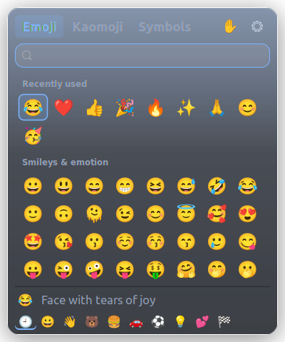
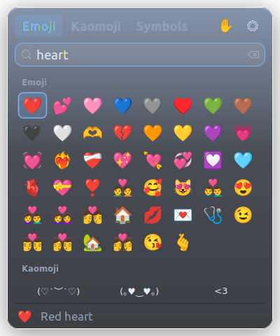
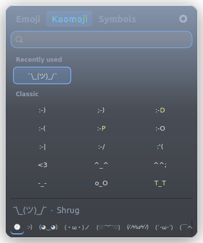

<div align="center">

# SuperV

**Clipboard, emoji and more Windows shortcuts for Linux.** The Win+V clipboard history, the Win+. emoji panel, Win+Shift+S screenshots, and PowerToys' plain-text paste, colour picker and text extractor: same keys.

Press <kbd>Super</kbd> + <kbd>V</kbd> for the clipboard history you know from Windows. The emoji panel, screenshots and the other shortcuts are there when you want them: each is one switch in the settings, and off until you turn it on.
Ubuntu, Linux Mint, Debian, Fedora, Arch, openSUSE and more.


<picture>
  <source media="(prefers-color-scheme: light)" srcset="docs/screenshot-light.png">
  
</picture>
<picture>
  <source media="(prefers-color-scheme: light)" srcset="docs/emoji-light.png">
  
</picture>

**[Website](https://saikatnjm.github.io/superv/) · [Versions and downloads](https://saikatnjm.github.io/superv/versions.html) · [Changelog](CHANGELOG.md) · [How it was built](https://njmsaikat.hashnode.dev/i-missed-windows-win-v-on-linux-so-i-built-it-in-360-kb-of-c)**

</div>

> **SuperDot is now part of SuperV.** Since 2.0 the emoji panel lives here. Installing SuperV 2 replaces SuperDot and keeps its settings.

## Why SuperV

Linux has no clipboard history out of the box, some desktops lose the clipboard when you close the app you copied from, and typing an emoji usually means a web search and copy-paste. SuperV copies how Windows does it.

**Only the clipboard history is on at first.** Everything else (emoji panel, screenshots, plain-text paste, colour picker, text from the screen) is a switch in the settings (Super+V, then ⚙), and the panel tells you so the first time you open it. A part that is off uses no memory, isn't loaded, and leaves its shortcut to your desktop.

### Clipboard history: <kbd>Super</kbd> + <kbd>V</kbd>

| | Windows (Win+V) | SuperV |
|---|:---:|:---:|
| History panel on <kbd>Win</kbd>/<kbd>Super</kbd> + <kbd>V</kbd> | ✓ | ✓ |
| Text **and** images (screenshots too) | ✓ | ✓ |
| Click or <kbd>Enter</kbd> pastes into the app you were using | ✓ | ✓ |
| Keeps the last 25 items, newest first | ✓ | ✓ |
| Copying something again moves it to the top | ✓ | ✓ |
| Pin items; pinned items survive restarts | ✓ | ✓ |
| History clears on restart (except pinned) | ✓ | ✓ |
| ⋯ menu: Delete, Pin/Unpin, Clear all | ✓ | ✓ |
| Turn history off; the panel offers **Turn on** | ✓ | ✓ |
| Clipboard survives closing the source app | ✓ | ✓ |
| Password managers' copies are not recorded | ✓ | ✓ |
| **Shows what you already pasted**: a ✓ on each pasted item, "Last pasted" on the latest, and the panel opens on the next one | ✗ | ✓ |
| The list keeps its order while you paste from it | ✗ | ✓ |
| <kbd>Super</kbd> + <kbd>Shift</kbd> + <kbd>S</kbd> screenshot → lands in history | ✓ | ✓ |
| Pick your **own** shortcut | ✗ | ✓ |
| Theme: System / Light / Dark | ✓ | ✓ |
| Adjustable text size in the panel | ✗ | ✓ |
| Move & resize the panel (remembered) | | ✓ |
| Free and open source | ✗ | ✓ |

**Pasting ten things one after another?** Copy them all, then paste them one by one: every item you have pasted gets a ✓ and fades, the latest is marked **Last pasted**, and the next time you press <kbd>Super</kbd> + <kbd>V</kbd> the selection is already on the next one, so <kbd>Enter</kbd> pastes it. The list doesn't reshuffle while you work through it. The ticks clear by themselves when you start copying a new batch.

### Emoji panel: <kbd>Super</kbd> + <kbd>.</kbd>

Off until you turn it on: click ☺ in the clipboard panel (it asks first), or use the **Emoji panel** switch in ⚙. Nothing is downloaded: every emoji, kaomoji and symbol is already inside the program.

| | Windows (Win+.) | SuperV |
|---|:---:|:---:|
| Emoji panel on <kbd>Win</kbd>/<kbd>Super</kbd> + <kbd>.</kbd> | ✓ | ✓ |
| Typed straight into the app you were using | ✓ | ✓ |
| Start typing to search ("heart", "cat", "party") | ✓ | ✓ |
| Recently used first, skin tones | ✓ | ✓ |
| Kaomoji ¯\\\_(ツ)\_/¯ and symbols (→ € ° ± Ω é…) | ✓ | ✓ |
| Switch between clipboard and emoji (☺ / 📋 buttons) | ✓ | ✓ |
| Search finds emoji, kaomoji **and** symbols at once | ✗ | ✓ |
| Your clipboard is left as it was | ✓ | ✓ |
| Hides emoji your font can't draw (no empty boxes) | ✓ | ✓ |
| Pick several in a row; resize the panel | ✓ / ✗ | ✓ |
| SuperV's colour (six palettes); optional glass look | ✓ / ✗ | ✓ |
| Turn the whole panel off | ✗ | ✓ |
| Pick your **own** shortcut | ✗ | ✓ |

<p align="center">
  
  
</p>

### More Windows shortcuts

Small, and each one off until you turn on its switch (Super+V, then ⚙). Nothing runs until you press it.

| Keys | Windows | What it does |
|---|---|---|
| <kbd>Ctrl</kbd> + <kbd>Super</kbd> + <kbd>Alt</kbd> + <kbd>V</kbd> | Ctrl+Win+Alt+V (PowerToys) | **Paste as plain text**: what you copied, without fonts, colours, links or images |
| <kbd>Super</kbd> + <kbd>Shift</kbd> + <kbd>C</kbd> | Win+Shift+C (PowerToys) | **Colour picker**: click anywhere on screen; the colour is copied as HEX, with RGB and HSL one click away |
| <kbd>Super</kbd> + <kbd>Shift</kbd> + <kbd>T</kbd> | Win+Shift+T (PowerToys) | **Copy text from the screen**: select an area; its text is copied. Needs Tesseract (the first press offers to install it) |
| <kbd>Super</kbd> + <kbd>Shift</kbd> + <kbd>S</kbd> | Win+Shift+S (Snipping Tool) | **Screenshot**, Flameshot-style: select an area, draw arrows, boxes, circles, text, highlights, numbers or blur on it, then copy, save, pin it on top of everything or copy its text |

**Screenshot keys:** P pen · L line · A arrow · R rectangle · C circle · M marker · T text · B pixelate · N numbers · V move the selection · mouse wheel or [ ] thickness · Ctrl+Z / Ctrl+Y undo / redo · Enter or Ctrl+C copy · Ctrl+S save · Ctrl+P pin · Ctrl+T copy its text · Ctrl+A whole screen · arrows move the selection (Shift: resize) · Esc close. The screen freezes at once: on GNOME (Wayland) SuperV uses GNOME's own instant screenshot (Shift+Print) behind the scenes, so there's no "Share screenshot?" dialog, and the file GNOME saves is removed; on X11 (Mint, Xfce, MATE) SuperV reads the screen itself. Other Wayland desktops are asked through the desktop portal, which may show a dialog.

**Copying text** works like the screenshot: the screen freezes, you drag over the text, and it is read and copied the moment you let go. On GNOME there is no dialog here either. **The colour picker** freezes the screen with a magnifier on X11 (Linux Mint, Xfce, MATE); on Wayland (Ubuntu, Fedora, KDE) it uses your desktop's own colour picker, because apps can't read single pixels of the screen there.

## Install

Pick your Linux family. Every package is about 130 KB and sets up click-to-paste for you. Need an older version? The [versions page](https://saikatnjm.github.io/superv/versions.html) keeps the last stable one of each line, and [GitHub Releases](https://github.com/saikatnjm/superv/releases) has every build.

### Ubuntu and Linux Mint: PPA (recommended, updates arrive with your system updates)

```bash
sudo add-apt-repository ppa:saikatnjm/superv
sudo apt install superv
```

Then **open SuperV once**: press <kbd>Super</kbd>, type **SuperV** and press <kbd>Enter</kbd> (on Mint: open the **Menu** and search for **SuperV**).
New versions then come through **Software Updater** (Ubuntu), **Update Manager** (Mint) or `sudo apt upgrade`.
The PPA covers Ubuntu 22.04, 24.04, 26.04 and 26.10, Linux Mint 21 and 22, and other systems based on them (Pop!_OS, Zorin, elementary).

### Ubuntu, Linux Mint, Debian, Pop!_OS, Zorin, elementary (no terminal)

1. Download **[superv_amd64.deb](https://github.com/saikatnjm/superv/releases/latest/download/superv_amd64.deb)**.
2. Double-click it and choose **Install** (Ubuntu Software, or Package Installer on Mint). Enter your password once.
3. **Open SuperV once to finish setup.** Press <kbd>Super</kbd>, type **SuperV** and press <kbd>Enter</kbd> (on Mint: open the **Menu** and search for **SuperV**).
   This first launch starts SuperV and sets up <kbd>Super</kbd> + <kbd>V</kbd>. After that, SuperV starts by itself every time you log in. Want emoji, screenshots or the other shortcuts too? Press <kbd>Super</kbd> + <kbd>V</kbd>, click ⚙ and turn on the ones you want.

Needs Ubuntu 22.04 / Mint 21 / Debian 12 or newer. On older releases, use the source install below.

### Fedora, openSUSE

1. Download **[superv.x86_64.rpm](https://github.com/saikatnjm/superv/releases/latest/download/superv.x86_64.rpm)**.
2. Double-click it to open it in **Software** (or run `sudo dnf install ./superv.x86_64.rpm`, or `sudo zypper install ./superv.x86_64.rpm` on openSUSE).
3. Open **SuperV** once from your app menu.

### Arch, Manjaro, EndeavourOS

```bash
git clone https://github.com/saikatnjm/superv.git
cd superv/packaging/arch && makepkg -si
```

Or download the ready-built **[superv-x86_64.pkg.tar.zst](https://github.com/saikatnjm/superv/releases/latest/download/superv-x86_64.pkg.tar.zst)** and run `sudo pacman -U superv-x86_64.pkg.tar.zst`. Then open **SuperV** once from your app menu.

### Any other Linux: from source

```bash
git clone https://github.com/saikatnjm/superv.git
cd superv
./install.sh                          # or: ./install.sh --hotkey "<Ctrl><Alt>v"
```

`install.sh` installs into your home folder, fetches any missing build tools with apt, dnf, pacman or zypper, and asks for your password **once** to turn on click-to-paste. Skip that with `./install.sh --no-sudo`; the panel then shows an **Enable** button that asks through the normal desktop password dialog when you want it.

### Updating

Installed from the PPA? Updates arrive with your normal system updates (`sudo apt update && sudo apt upgrade`). Otherwise, install the new package the same way. **SuperV notices it was updated and restarts itself into the new version** as soon as the panel is closed, keeping what's on your clipboard. (Coming from 1.1.2 or older? Run `superv --quit` and open SuperV once; from 1.2.0 on, this is automatic.)

**Updating to 2.1** keeps what you already use: if the emoji panel or another feature was on, it stays on. New installs start with the clipboard only. **Had SuperDot?** The SuperV 2 package replaces it, brings its settings and recently used emoji along, and turns the emoji panel on for you.

### Your own shortcut, theme and text size

Open the panel and click ⚙:

- **Clipboard history:** on or off.
- **Features:** a switch each for the emoji panel, paste as plain text, colour picker, copy text from screen and screenshot. All off at first; turning one on registers its shortcut with your desktop, turning it off gives the shortcut back.
- **Colour** and **Theme:** one palette (violet is SuperV's; azure, graphite, emerald, amber, rose) and one theme (System, Light, Dark) for every SuperV window: clipboard, emoji panel, colour card, screenshot tool.
- The emoji panel's own settings (shortcut, glass, skin tone, what happens when you pick) are behind the ⚙ in the emoji panel.
- **Shortcut:** click it and press a combo that uses **Super**, or **Ctrl+Alt**, plus a key (e.g. <kbd>Super</kbd>+<kbd>V</kbd>, <kbd>Ctrl</kbd>+<kbd>Alt</kbd>+<kbd>V</kbd>). A green ✓ confirms it's saved; if a combo can't be used, SuperV tells you why. (Ctrl+V, Ctrl+Shift+V and Alt+V are refused because apps need them for pasting and menus.) SuperV moves conflicting desktop shortcuts out of the way and restores them if you change your mind. Changed it in your desktop's own keyboard settings instead? SuperV picks that up too.
- **Text size:** A− / A+, from 80% to 160%, for the clipboard items. The default is 100%, your desktop's normal size.
- **Clear history** removes everything except pinned items. **Reset settings** puts theme, text size, panel size and position, and the shortcut back to their defaults; your history is kept.

Drag the panel's header to move it and drag any edge to resize it; SuperV remembers both. Double-click the header to reset.

## Keyboard shortcuts

| Keys | What it does |
|---|---|
| <kbd>Super</kbd> + <kbd>V</kbd> | Open / close clipboard history (or your own shortcut) |
| <kbd>↑</kbd> <kbd>↓</kbd> | Move between items |
| <kbd>Enter</kbd> or click | Paste the item into the app you were using; it gets a ✓, and the next opening starts on the next item |
| <kbd>Delete</kbd> | Remove the selected item |
| <kbd>Esc</kbd> or click elsewhere | Close the panel |
| <kbd>Super</kbd> + <kbd>Shift</kbd> + <kbd>S</kbd> | Screenshot (SuperV's tool when its switch is on, your desktop's otherwise); the image appears in your history |
| <kbd>Ctrl</kbd> + <kbd>C</kbd> / <kbd>X</kbd> / <kbd>V</kbd> | Work as always |

**Emoji panel**

| Keys | What it does |
|---|---|
| <kbd>Super</kbd> + <kbd>.</kbd> | Open / close the emoji panel (or your own shortcut) |
| type | Search emoji, kaomoji and symbols by name or keyword |
| <kbd>←</kbd> <kbd>↑</kbd> <kbd>↓</kbd> <kbd>→</kbd>, <kbd>Page Up</kbd> / <kbd>Page Down</kbd> | Move around |
| <kbd>Enter</kbd> or click | Insert it where you were typing; the panel stays open for the next one |
| <kbd>Shift</kbd> + <kbd>Enter</kbd> or <kbd>Shift</kbd> + click | Insert and close the panel |
| <kbd>Tab</kbd> | Emoji → Kaomoji → Symbols |
| <kbd>Esc</kbd> or click outside | Clear the search, then close |
| <kbd>Super</kbd> + <kbd>V</kbd> | Switch to the clipboard history |

## Lightweight by design

SuperV is a single C program built on GTK 3, which Ubuntu and Mint already have loaded in memory. It uses no interpreter, no Electron and no runtime. Everything runs in **one** background process, and a feature that is off isn't loaded at all.

| | |
|---|---|
| Size | about 360 KB with every emoji, kaomoji and symbol built in (packages about 130 KB) |
| Memory, clipboard only (how it starts) | about 5.5 MB private |
| Memory, emoji panel on | about 7 MB private, about 11 MB once you have opened it (most of the rest is GTK and the emoji font, shared with your desktop) |
| Colour picker, text reader, screenshot tool | nothing until you press the shortcut; freed again when you are done |
| CPU when idle | 0%: it wakes only when the clipboard changes or you press a shortcut |
| Popup | about 0.03 s from shortcut to panel (0.05 s the first time) |
| Disk writes | history is written at most once every 0.4 s, pictures in the background, so copying never waits |

The setup helper (`superv-setup`, Python) only runs during install, when you change a shortcut or turn a feature on or off. Text recognition runs Tesseract only while it reads the area you selected.

## Works on

| Desktop | Distros | Session | Status |
|---|---|---|---|
| GNOME | Ubuntu, Fedora Workstation, Debian, Pop!_OS 22.04, Zorin, Arch/Manjaro GNOME | Wayland & X11 | ✓ fully supported |
| Cinnamon | Linux Mint, Fedora Cinnamon, Arch | X11 | ✓ fully supported |
| MATE, Xfce | Mint MATE/Xfce, Xubuntu, Ubuntu MATE, Fedora spins | X11 | ✓ supported |
| Budgie, Pantheon (elementary) | Ubuntu Budgie, elementary OS | X11 / Wayland | should work (GNOME-style shortcuts) |
| KDE Plasma 5 & 6 | Kubuntu, KDE neon, Fedora KDE, openSUSE, Manjaro KDE | Wayland & X11 | **experimental** for the clipboard: SuperV sets Meta+V and turns off Klipper's Meta+V for you; the emoji panel frees Plasma's own Meta+. picker and gives it back when turned off |
| Sway, Hyprland, i3, COSMIC | various | Wayland / X11 | works; add the shortcut yourself (SuperV prints the exact line) |

What every setup needs: an X11 session or XWayland (on by default on GNOME, KDE and most Wayland desktops), GTK 3 and Python 3 with GObject (installed automatically by the packages). Colour emoji need an emoji font such as Noto Color Emoji, which Ubuntu, Mint and Fedora already have. Click-to-paste uses `/dev/uinput` via systemd's `uaccess`; on distros without systemd, picking an item still copies it and X11 apps still get pasted.

The prebuilt `.deb` needs glibc 2.35+ (Ubuntu 22.04, Mint 21, Debian 12 or newer); everything else is built for your system.

## How it works

The full story, with the problems along the way, is in the blog post [I missed Windows' Win+V on Linux, so I built it in 360 KB of C](https://njmsaikat.hashnode.dev/i-missed-windows-win-v-on-linux-so-i-built-it-in-360-kb-of-c). In short:

- **Clipboard watching.** SuperV runs on X11/XWayland and listens for XFixes clipboard-owner changes. GNOME keeps the Wayland and XWayland clipboards in sync, so copies from native Wayland apps are captured too. It's event-driven, with no polling.
- **Keeping the clipboard alive.** When the app that owns the clipboard quits, SuperV puts the last item back, as Windows does.
- **Pasting.** After you pick an item, SuperV puts it on both CLIPBOARD and PRIMARY, refocuses your app and presses <kbd>Shift</kbd> + <kbd>Insert</kbd>, which pastes in normal apps *and* terminals on any keyboard layout. On Wayland the key press goes through a virtual keyboard (`/dev/uinput`); on X11 sessions it uses XTest.
- **Emoji.** The emoji panel never takes keyboard focus itself (an invisible 1-pixel helper window does), so it can stay open while your app receives each emoji. It remembers your clipboard, puts the emoji there marked like a password (so clipboard histories, SuperV's included, don't record it), presses <kbd>Shift</kbd> + <kbd>Insert</kbd>, and puts your clipboard back as soon as the app has read it. The emoji list (Unicode with CLDR search keywords) is built in: no data files, no network.
- **Storage.** History lives in `~/.local/share/superv/`, settings in `~/.config/superv/`. Details below.

## Privacy & security

SuperV only touches your clipboard and never leaves your machine.

- **No network, ever.** No telemetry, analytics, crash reports or update checks. The binary doesn't even import network functions, which you can check yourself with `nm -D --undefined-only $(command -v superv) | grep -wE "socket|connect|getaddrinfo|send|recv"` (no output).
- **Local, owner-only storage.** Folders are `0700` and files `0600`, enforced every time SuperV starts. Only your user can read your history.
- **Short-lived by default.** Unpinned items are wiped on reboot. **Clear all** and turning history off delete them immediately.
- **Secrets are skipped.** Copies marked by password managers (`x-kde-passwordManagerHint`, used by KeePassXC and others) are never recorded, and neither are file copies from your file manager.
- **Password managers:** copies marked as secret (KeePassXC and others that set `x-kde-passwordManagerHint`) are skipped. Apps that don't mark their copies, such as some browser and Electron password managers, *are* recorded like any other text; pin nothing sensitive, and use **Delete** or **Clear history** if a password ends up in the list.
- **Nothing sensitive in logs.** Log lines report status only, never clipboard content.
- **What the click-to-paste permission means.** A udev rule lets the logged-in user create a virtual keyboard (`/dev/uinput`), which SuperV uses to press <kbd>Shift</kbd>+<kbd>Insert</kbd> after you pick an item. On X11, every app already has this ability. Uninstalling removes the rule.
- **The website** sets no cookies, has no analytics and makes no third-party requests; the theme toggle is stored in your browser only.

Found a security problem? Please open a [private security advisory](https://github.com/saikatnjm/superv/security/advisories/new) instead of a public issue.

## Settings

Most people never need to touch a file: ⚙ in the panel has every switch, the shortcut, the colour and theme, and **Clear history**. Everything else is in `~/.config/superv/config.ini`:

```ini
[superv]
history_enabled=true
max_items=25                     # unpinned items to keep
max_text_bytes=4194304           # 4 MB per item, like Windows
clear_unpinned_on_reboot=true
restore_when_owner_exits=true
paste_keys=shift+insert          # or ctrl+v, ctrl+shift+v, none
paste_delay_ms=180
hotkey=<Super>v
emoji_panel=false                # the features: all off until you turn them on
plain_paste=false
color_picker=false
text_extractor=false
screenshot=false
theme=auto                       # auto (System), light, dark: for every SuperV window
palette=violet                   # violet, azure, graphite, emerald, amber, rose
font_scale=100                   # text size in %, 80-160
width=400                        # panel size and position (set by dragging)
height=520
pos_x=-1                         # -1 = open centred / next to the pointer
pos_y=-1
```

`emoji_panel`, `plain_paste`, `color_picker`, `text_extractor` and `screenshot` turn each feature on or off (the switches in ⚙ do the same, and also register or give back the shortcut). Their shortcuts are in `~/.config/superv/shortcuts.ini`; change one with `superv-setup --feature color_picker --hotkey '<Super>k'` (in `/usr/lib/superv/`). The emoji panel's settings are in `~/.config/superv/emoji.ini`, also editable from its own ⚙ menu:

| Key | Default | |
|---|---|---|
| `hotkey` | `<Super>period` | change it from the emoji panel's ⚙ menu |
| `paste_keys` | `shift+insert` | `ctrl+v`, `ctrl+shift+v`, or `none` (copy only) |
| `skin_tone` | `0` | 0 default yellow, 1 light … 5 dark |
| `stay_open` | `true` | stay open after picking, to pick several |
| `restore_clipboard` | `true` | put back what you had copied |
| `glass` | `false` | `true` for a see-through glass panel (the **Glass effect** switch) |

After editing, restart SuperV: `superv --quit && superv --daemon &`

## Command line

```text
superv                          open / close the clipboard panel (what Super+V runs)
superv --show                   open the clipboard panel
superv --emoji                  open / close the emoji panel (what Super+. runs)
superv --emoji --tab kaomoji    open it on a tab: emoji, kaomoji or symbols
superv --emoji --search heart   open it with a search
superv --emoji --insert "¯\_(ツ)_/¯"   type text into the focused app (bind it to a key!)
superv --daemon                 start in the background (done automatically at login)
superv --clear                  clear history (pinned items stay)
superv --quit                   stop SuperV
superv --plain-paste            paste what you copied as plain text (what Ctrl+Super+Alt+V runs)
superv --pick-color             pick a colour on screen (what Super+Shift+C runs)
superv --extract-text           copy text from an area of the screen (what Super+Shift+T runs)
superv --screenshot             take a screenshot and mark it up (what Super+Shift+S runs); --delay 3 waits 3 s
superv --doctor                 check the setup: daemon, shortcuts, auto-paste, emoji font, Tesseract, memory use
```

## Troubleshooting

Run `superv --doctor` first.

- **Super+Shift+T says it needs Tesseract.** Install it once: `sudo apt install tesseract-ocr` (Ubuntu, Mint, Debian), `sudo dnf install tesseract` (Fedora), `sudo pacman -S tesseract tesseract-data-eng` (Arch). For another language add its data, e.g. `tesseract-ocr-ben`.
- **The colour picker or text capture says it isn't available.** On Wayland they need your desktop's portal (`xdg-desktop-portal-gnome` or `-kde`), which GNOME and KDE Plasma install by default.
- **A shortcut shows a card saying the feature is off.** That feature's switch is off, which is how every feature except the clipboard starts: press Super+V, click ⚙ and turn it on.
- **Super+. does nothing.** Check that **Emoji panel** is on (Super+V → ⚙). Still nothing? `superv --doctor` shows whether the shortcut is registered. No colour emoji? Install Noto Color Emoji (`fonts-noto-color-emoji`, `google-noto-color-emoji-fonts` or `noto-fonts-emoji`).
- **Super+V does nothing.** Open SuperV once from the app menu (or log out and back in), then check `superv --doctor`. On KDE Plasma 5, log out and back in once after setup. On Sway, Hyprland, i3 or COSMIC, add the shortcut line that `superv-setup --hotkey "<Super>v"` prints (for a feature: `superv-setup --feature emoji --hotkey "<Super>period"`).
- **The panel still shows the old version after an update.** Run `superv --quit` and open SuperV again (only needed when updating *from* 1.1.2 or older).
- **A copied image doesn't show up, or shows as text.** Run `superv --quit`, then `SUPERV_DEBUG=1 superv --daemon` in a terminal, and copy the image again. The log lists the clipboard *formats* the app offered (never the content), which is exactly what a bug report needs.
- **The item is copied but not pasted.** Click-to-paste isn't enabled yet: open the panel and click **Enable**, or install the `.deb`. (Apps running under X11, such as Chrome, VS Code and Electron apps, paste even without it.)
- **An app doesn't paste with Shift+Insert.** Set `paste_keys=ctrl+v` in the config.

## Uninstall

Either way, SuperV stops, and your desktop's shortcuts go back to how they were (Super+V opens the notification list again on Ubuntu, and every other key SuperV used goes back to whatever had it before).

**Installed a package** (pick one):

- **Ubuntu:** Ubuntu Software → **Installed** → SuperV → **Uninstall**
- **Linux Mint:** open the **Menu**, right-click **SuperV** → **Uninstall** (or use Software Manager)
- **Fedora:** Software → **Installed** → SuperV → **Uninstall**
- **Terminal:** `sudo apt remove superv` (Debian family) · `sudo dnf remove superv` (Fedora) · `sudo zypper remove superv` (openSUSE) · `sudo pacman -R superv` (Arch)

Your clipboard history and settings are kept in case you reinstall. To delete them as well:

```bash
rm -r ~/.local/share/superv ~/.config/superv
```

**Installed from source:**

```bash
~/.local/lib/superv/uninstall.sh          # keeps your history and settings
~/.local/lib/superv/uninstall.sh --purge  # deletes them too
```

## Build from source

```bash
make                          # builds ./superv (build dependencies for each distro are listed in the Makefile)
sudo make install             # installs to /usr/local (PREFIX=/usr DESTDIR=… for packaging)
```

Packages: `packaging/build-deb.sh` (.deb), `packaging/rpm/superv.spec` (.rpm) and `packaging/arch/PKGBUILD` (Arch). Pushing a tag like `v2.0.0` makes GitHub build all three and attach them to the release (`.github/workflows/release.yml`). `make data` refreshes the built-in emoji list from Unicode and CLDR. Contributions are welcome: see [CONTRIBUTING.md](CONTRIBUTING.md).

The GitHub Pages site lives in [`docs/`](docs/). In the repository settings, set Pages to **Deploy from branch → `main` → `/docs`**.

## Like it?

If SuperV saves you time, please give the repo a ⭐. It helps other Linux users find it.

## License

MIT ([LICENSE](LICENSE)). Emoji names and keywords come from Unicode's [emoji-test.txt](https://unicode.org/Public/emoji/latest/emoji-test.txt) and [CLDR](https://github.com/unicode-org/cldr) annotations, under the Unicode License v3 ([LICENSES/Unicode-3.0.txt](LICENSES/Unicode-3.0.txt)).

Windows is a trademark of Microsoft; SuperV is an independent project and is not affiliated with Microsoft.
